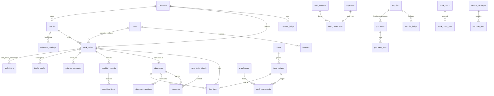

# Jeep City System — Phase 0 Plan

Status: **approved 2026-10-30** with all defaults. Phase 1 (design) approved; Phases 2 (backend and data), 3 (core modules, screens on the API) and 4 (offline and sync) done. Questions for Aslam (§3) stay open until he confirms. Every assumption is also in [DECISIONS.md](DECISIONS.md) with an ID (D-xx) so it can be corrected later.

---

## 1. Final stack

| Layer | Choice | Why |
|---|---|---|
| Repo | npm workspaces monorepo, TypeScript everywhere | npm 11 is already installed; no extra tool. Shared code is written once for server, desktop and phone. |
| Shared logic | `packages/core`: money, totals formulas, Arabic number-to-words, plate/phone/Arabic-search normalizers, permission matrix, zod schemas | The phone app (Phase 7) reuses all of it unchanged. Server and client run the same validation. |
| Backend | Node.js + **Fastify 5** + **zod** contracts (typed routes, OpenAPI generated from the zod schemas) | Small, fast, typed end to end. REST + OpenAPI is easy to call from any future client. |
| Database | **PostgreSQL 16**, **Drizzle ORM**, SQL migration files | Real transactions for money and stock. Drizzle stays close to SQL and generates plain migration files you can read. |
| Dev / test DB | **PGlite** (Postgres compiled to WASM, runs inside Node) | This machine has no Docker or Postgres. PGlite gives real Postgres for tests and local dev without installing anything. Production uses real Postgres. |
| Client | **React 19 + Vite + TypeScript**, own design system (CSS custom properties, native `<dialog>` / popover), Lucide icons used sparingly | No UI kit to fight against for RTL and the square-cut brand look. |
| Local-first store | **IndexedDB via Dexie** + outbox queue | Works the same in the desktop shell, a PWA and a phone wrapper. No native SQLite build needed. |
| Desktop shell | **Tauri 2** (WebView2, built into Windows 11) | ~10 MB installer instead of ~100 MB for Electron, lower RAM on shop PCs. It needs the Rust toolchain on this machine **only at Phase 6** (packaging); Phases 1–5 run in a browser via Vite. Fallback: Electron (D-27). |
| Phone (Phase 7) | Same React client as an installable PWA, or wrapped with Capacitor | Same code, same Dexie store, same sync. |
| Realtime | **SSE** (`/sync/events`) that only says "new changes up to seq N"; the client then pulls | One-way push is enough, survives proxies, auto-reconnects. |
| Auth | **argon2id** (`@node-rs/argon2`, prebuilt, no compiler), access token 15 min + rotating refresh token, `@fastify/rate-limit` on login | Matches the security rules in the brief. |
| Printing | HTML + CSS `@page` templates (A4 statement, A4 Job Card, A4 condition report, 80 mm receipt, 40×30 mm labels) through the OS print dialog | Works with any printer driver. ESC/POS direct printing later (D-31). |
| Exports | Excel via `exceljs`, PDF via print-to-PDF | No server-side headless browser on a small VPS. |
| Tests | **Vitest** (core + server on PGlite), sync tests with two simulated offline devices | |
| Hosting | One small VPS (~USD 5/month, or your existing one): Docker Compose with `caddy` (auto HTTPS), `api`, `postgres`, `backup` | Cheapest safe option. |
| Backups | `pg_dump` daily + files folder, 14 days on the VPS, copied off-site with `rclone` (Cloudflare R2 / Backblaze B2 / Google Drive), restore drill script | See §6. |

Own sync code instead of a sync product (ElectricSQL, PowerSync, Replicache): the hard parts here are business rules (server numbering, locked statements, stock ledger, role filtering). A product would add a service on the VPS and still leave those rules to us.

---

## 2. Folder structure

```
jeep-city-system/
  PLAN.md  DECISIONS.md  README.md
  package.json                  npm workspaces
  packages/
    core/                       shared, no I/O
      src/money.ts              piasters, quantities ×1000, rounding
      src/totals.ts             ★ ALL statement formulas (for Aslam), + totals.test.ts
      src/ar-words.ts           number → Arabic words, + tests
      src/normalize.ts          Arabic search, plates, Egyptian phones → wa.me
      src/permissions.ts        role matrix used by server AND UI
      src/schemas/              zod schemas per entity and per sync mutation
    ui/                         design system: tokens.css, fonts (Cairo, Barlow woff2), components
  apps/
    client/                     React app (screens, Dexie store, outbox, sync client, print templates)
    server/                     Fastify API, Drizzle schema + migrations, auth, sync, audit, backups API
    desktop/                    Tauri shell that loads the client build
  deploy/
    docker-compose.yml  Caddyfile  backup/  RESTORE.md
```

---

## 3. Statement totals — ★ flag for Aslam

All formulas live in **one file, `packages/core/src/totals.ts`**, documented and unit-tested. Changing a rule means changing that one file and its test.

Money is stored as **integer piasters** (1 EGP = 100). Quantities are stored as **integer thousandths** (7.5 L = 7500), so no floats anywhere.

```
Categories c: labor (مصنعيات), parts (قطع غيار), oils (زيوت), materials (خامات), paint (بويات)

line value          = round(qty × price)                     rounded half-up to 1 piaster
gross[c]            = Σ line values of category c             إجمالي المصنعيات / إجمالي قطع الغيار …
discount[c]         = fixed amount, or round(gross[c] × % ÷ 100), never more than gross[c]
                      (labor and parts shown; oils/materials/paint hidden until enabled in settings)
net[c]              = gross[c] − discount[c]                  صافي المصنعيات / صافي قطع الغيار / صافي الزيوت
tax[c]              = 0 by default; if VAT enabled and customer not exempt: round(net[c] × rate[c])
إجمالي بيان         = Σ gross[c]
إجمالي خصم          = Σ discount[c]
إجمالي خامات        = net[materials]
أجمالي المطلوب      = Σ net[c] + Σ tax[c]                     (also in Arabic words)
paid                = Σ payments except آجل
remaining / debt    = المطلوب − paid                          آجل part goes to the customer's debt ledger
```

Test fixture (real statement): labor 1 × 2500, discount 450 → net 2050. Parts 5250 + 850 + 1850 + 300 + 2000 + 300 + 650 + 150 = 11350, discount 400 → net 10950. إجمالي خصم 850, إجمالي بيان 13850, المطلوب **13000**, words "فقط ثلاثة عشر ألف جنيه مصري".

**Questions for Aslam** (the fixture forces one of them):
1. The fixture counts the engine oil (7 × 750 = 5250) **inside** parts. So either the old system puts oils in the parts total, or the oil was typed as a part on that paper. When does صافي الزيوت get a value? Default: a line goes to the category of its item type; the fixture enters the oil as a parts line (D-08).
2. Is إجمالي خامات gross or net of the materials discount? Default: net (D-09).
3. Rounding of percent discounts: half-up to the piaster? Default: yes (D-10).
4. With VAT on: is tax on the net after discount? Default: yes (D-11).

---

## 4. Database schema (ERD)

Every synced table has: `id uuid` (generated on the client, UUIDv7), `created_at`, `updated_at` (timestamptz, UTC), `created_by`, `device_id`, `server_seq bigint` (global change counter used by pull), `archived_at` (nothing is hard-deleted). Money columns end in `_pt` (piasters, bigint); quantities in `_milli` (bigint).



Key columns (not exhaustive):

| Table | Key columns |
|---|---|
| `users` | username, display_name, role (`admin`/`engineer`), password_hash, active |
| `technicians` | name, phone, active (separate from users) |
| `customers` | name, mobile, office_phone, home_phone, whatsapp, governorate, address, occupation, notes, **internal_notes** (never printed), opening_balance_pt |
| `vehicles` | customer_id, plate_type → plate_types, plate_letters, plate_digits, plate_key, chassis, license_no, make, model, variant, year, engine_size, engine_no, model_no, color, warranty_end |
| `odometer_readings` | vehicle_id, km, read_at, work_order_id, override_reason (when lower than previous) |
| `work_orders` | number, type (`repair`/`inquiry`/`condition`), status (`open`/`ready`/`delivered`/`invoiced`/`cancelled`), vehicle_id, customer_id, representative, reception_user_id, entered_at, expected_at, odometer_in, comeback, fault_type, repair_type, booking (`booked`/`walk_in`), insurance_company, complaint, engineer_notes, customer_notes, internal_notes, fuel_level, belongings (jsonb), estimate_pt, signature_file_id |
| `intake_marks` | work_order_id, vehicle_id, view (top/left/right/front/back), x, y, kind (scratch/dent/damage), note, photo_file_id |
| `estimate_approvals` | work_order_id, old_pt, new_pt, approved_by_name, method (phone/WhatsApp/in person), at, recorded_by |
| `doc_lines` | work_order_id?, statement_id?, category, variant_id, code, name, qty_milli, price_pt, technician_id, finished_at, stock_movement_id |
| `statements` | number, kind (`statement`/`direct_sale`), work_order_id?, customer_id, vehicle_id?, statement_date, exit_at, discount type+value per category, tax_exempt, totals snapshot (all §3 values), amount_due_pt, status (`final`/`cancelled`), cancel_reason, version |
| `statement_revisions` | statement_id, rev_no, user_id, at, before (jsonb), after (jsonb), reason |
| `payments` | statement_id?, customer_id, method_id, amount_pt, reference, at, user_id, kind (`statement`/`debt_settlement`/`refund`) |
| `payment_methods` | name, needs_reference, is_credit, sort, active |
| `customer_ledger` / `supplier_ledger` | party_id, amount_pt (signed), kind, ref_type, ref_id, at — balance = sum |
| `items` | code, name_ar, name_en, type (`part`/`oil`/`material`/`labor`/`paint`), category_id, unit, location, notes, photo_file_id, active |
| `item_variants` | item_id, grade (`original`/`copy`/`used`/`none`), sell_price_pt, avg_cost_pt (admin only), barcode, min_qty_milli, active |
| `stock_movements` | variant_id, warehouse_id, qty_milli (signed), kind (`purchase_in`/`issue_out`/`issue_return`/`sale_out`/`sales_return`/`purchase_return`/`adjustment`/`count`), unit_cost_pt, ref_type, ref_id, reason — **append-only** |
| `purchases` / `purchase_lines` | number, kind (`invoice`/`return`), supplier_id, date, payment (`paid`/`credit`); variant_id, qty_milli, unit_cost_pt |
| `cash_sessions` / `cash_movements` | opened_at, opening_pt, closed_at, expected_pt, counted_pt, difference_pt; amount_pt (signed), kind, ref — **append-only** |
| `expenses` | category_id, amount_pt, at, paid_by, notes, file_id |
| `bonuses` | user_id, amount_pt, at, reason, statement_id? |
| `condition_reports` / `condition_items` | work_order_id, vehicle_id, at, user_id; system, item, status (`good`/`watch`/`urgent`), note, photo_file_id, recommended_variant_id, recommended_price_pt |
| `stock_counts` / `stock_count_lines` | started_by, status, approved_by; variant_id, system_qty_milli, counted_qty_milli |
| `service_packages` / `package_lines` | name; variant_id, qty_milli |
| `reminders` | vehicle_id, customer_id, due_date, due_km, kind, note, done_at |
| `share_tokens` | token_hash, doc_type, doc_id, expires_at, revoked_at |
| `files` | sha256, mime, size, path (photos, signatures, attachments) |
| `plate_types` | id, label, bar_color (null = to confirm), text_color, digits_only, small, to_confirm, sort, active (D-69) |
| `settings` | key, value (jsonb): shop info, start numbers, texts, WhatsApp templates, payment method order, label sizes, devices, VAT, timeouts, categories |
| `audit_log` | at, user_id, device_id, action, entity, entity_id, before, after |
| `number_series` / `number_blocks` | series, next_value; series, device_id, from, to, next |
| `sync_mutations` | mutation_id (idempotency key), device_id, user_id, result, at |
| `warehouses` | one row now; `warehouse_id` on stock rows for later |

Stock on hand = Σ `stock_movements.qty_milli` per variant (plus a cached total table refreshed in the same transaction, for speed). Parts issue (إذن صرف) writes the movement **when the part is issued to the work order**, not at invoicing. Direct sale writes it at sale.

Cost: **weighted average cost**, recomputed on each purchase receipt; every outgoing movement stores the cost at that moment, so profit reports never change later (D-13).

---

## 5. Sync design

**Server = source of truth.** Each device keeps a local copy in IndexedDB.

1. **Writes** go to the local DB and to an **outbox** as *commands*, not raw rows: `workOrder.create`, `line.add`, `part.issue`, `statement.finalize`, `payment.add`, `customer.update`… Each has a `mutation_id` (idempotency key), the user, the device, and the base version.
2. **Push:** the outbox is sent in order. The server runs each command in one DB transaction, checks permissions **on the server**, validates, assigns numbers, writes the audit log, and returns the result. Re-sending the same `mutation_id` returns the saved result (no duplicates after a dropped connection).
3. **Pull:** `GET /sync/pull?since=<seq>` returns rows changed after that `server_seq`, filtered by role.
4. **Realtime:** SSE tells every connected device "changes up to seq N"; it pulls within a second or two. A car received on PC 1 shows on PC 2 almost at once.
5. **Status indicator** in the top bar: متصل / يتم المزامنة (with outbox count) / غير متصل.

**Numbering** (start numbers from Settings):

| Series | How assigned | Offline |
|---|---|---|
| أمر شغل (from 13548) | Each device holds a **reserved block of 20** numbers from the server | Works offline; the Job Card prints with its real number. Numbers from two PCs can interleave out of time order, and unused numbers in a retired device's block become gaps (D-15). |
| بيان عميل (from 9309) | **Server only**, at finalize, gap-free | Saved as "بانتظار الرقم"; customer copy prints as preview until synced (D-16). |
| بيع مباشر, مشتريات, مرتجع | Server only | Same as statements. |

**Conflict policy:**

| Data | Policy |
|---|---|
| Stock movements, cash movements, payments, ledgers, audit, odometer readings | Append-only, never conflict. |
| Stock going below zero because two offline PCs issued the last unit | Accepted (it already happened physically), flagged in alerts for Admin. |
| Document numbers, statement status, lock, totals | Server-authoritative. |
| Saved statement edited by an engineer | **Rejected by the server** (403, Arabic message). |
| Admin edit of a saved statement | Server checks base version; if someone else changed it first, the admin sees both versions and re-applies. Creates a revision + compensating stock/ledger entries. |
| Work order lines (open order) | Each line is its own row, so two PCs adding lines merge naturally. |
| Header fields of open work orders, customers, vehicles, items | Last-write-wins **per field**, with the older value kept in the audit log. |
| Prices, settings, users | Admin only, last-write-wins, audited. |

**Kept off engineers' disks:** cost prices, profit, cash drawer, ledgers and reports are never pulled to an engineer device. Admin views of those read online from the server, so they need a connection (D-20).

**Login and outages:** a device keeps a refresh token for each user who logged in on it (max 30 days). During an internet cut, work continues; "switch user" offline works only for users who logged in on that PC before (local verifier); their queued commands upload under their own token when the line returns (D-21).

---

## 6. Backups and deployment (Phase 6) — shop server, no VPS (D-88)

- **Server:** a dedicated PC in the shop running Ubuntu Server with Docker Compose: `db` (PostgreSQL), `api` (the Fastify server, also serving the web app), `backup`, `cloudflared`. Every service has `restart: unless-stopped`, and Docker starts on boot, so everything comes back after a power cut.
- **Access:** in the shop, staff PCs use the server's LAN address (fixed IP or DHCP reservation). Outside the shop, and for phones, the Cloudflare Tunnel address (HTTPS, no open router ports). The desktop app tries the LAN address first and falls back to the tunnel. When the internet is down, the LAN keeps working; phones sync whenever they reach either address.
- **Backups:** the `backup` container makes a daily `pg_dump` plus the files folder (signatures), gzipped, kept 14 days on the server, and copies each day's dump to cloud storage with `rclone`.
- **Restore:** `deploy/restore.sh` restores a chosen dump. `deploy/restore-drill.sh` restores last night's dump into a scratch database and compares row counts. It is run before go-live and the result is logged.
- **Health check:** `GET /health` (database reachable, last backup age); Docker health checks restart a stuck service.
- **Secrets:** in `deploy/.env` on the server only (git-ignored); an `.env.example` documents every key.
- **README:** `deploy/README.md` covers setup step by step and recovery (dead disk, new PC, restore from the cloud copy).
- **Admin Settings:** backup status and "backup now".

---

## 7. Permission matrix

Enforced on the server by `packages/core/src/permissions.ts`; the UI uses the same file only to hide buttons.

| Action | إدارة Admin | مهندس Engineer |
|---|:-:|:-:|
| Log in, switch user, global search | ✓ | ✓ |
| Receive car, create work order, Job Card, intake diagram, photos, signature | ✓ | ✓ |
| Condition report, estimate approvals, WhatsApp messages, share links | ✓ | ✓ |
| Issue parts to a work order, return unused parts | ✓ | ✓ |
| Issue more than available stock | ✓ (with reason) | ✗ |
| Save odometer lower than previous | ✓ (with reason) | ✗ |
| Create statement / direct sale, record payments on it | ✓ | ✓ (D-22) |
| **Edit a saved statement** | ✓ (revision) | ✗ server rejects |
| Cancel a statement (with reason) | ✓ | ✗ |
| Collect customer debt payments | ✓ | ✗ (D-23) |
| Customers and vehicles: create, edit contact data | ✓ | ✓ |
| Customer balances and ledgers | ✓ | ✗ (sees a "عليه مديونية" badge only) |
| Items: view name, code, sell price, stock | ✓ | ✓ |
| Items: create, edit, change prices | ✓ | ✗ |
| Cost prices, profit | ✓ | ✗ |
| Stock count: enter counted quantities | ✓ | ✓ |
| Stock count: approve adjustments, manual adjustments | ✓ | ✗ |
| Suppliers, purchases, purchase returns | ✓ | ✗ |
| Sales returns | ✓ | ✗ (D-24) |
| Cash drawer, expenses | ✓ | ✗ |
| Bonuses | ✓ | ✗ |
| Reports | ✓ | ✗ (only own work list) |
| Labels, scanner use | ✓ | ✓ |
| Settings, users, technicians list, devices, import, backups, audit log | ✓ | ✗ |

---

## 8. Phase 1 preview (what you will review next)

Built as the real React app (`apps/client`) with static sample data, so nothing is thrown away. Paper theme from the brand system: white surfaces, `#F5F3EC` panels, black text, yellow only as a fill (primary button, active nav, highlights), dark-gold `#7A5C00` for accent text, square corners with 45° cuts, Cairo + Barlow bundled locally. A black navigation rail on the right carries the colour badge. Three muted status colours (green/amber/red) are added for grades and condition states, since the brand has none (D-05).

Screens: login + switch user · dashboard (admin / engineer) with cars-in-shop board · reception board · intake (car diagram, fuel, belongings, photos, signature) · work order with labor/parts tabs, quick labor, service packages, parts issue · statement with totals block, words and split payments · condition report · statements list · items list + detail (grades, stock ledger) · suppliers with WhatsApp · customer + car file with history and odometer · cash drawer · one report · settings (incl. Devices) · print: A4 statement, A4 Job Card, A4 condition report, 80 mm receipt · Ctrl+K search.

---

## 9. Open questions (defaults are used until you answer)

1. **Oils in totals** — §3 question 1, with Aslam.
2. **Work order numbers offline** — device blocks (gaps and interleaving possible) OK, or provisional numbers until sync (Job Card printed offline shows a temporary number)?
3. **Statement printed while offline** — preview only until the server gives the number. OK?
4. **Cancelling a statement** — return its parts to stock and refund recorded payments automatically? Default: yes for both, refund shown as cash out (D-25).
5. **Direct sale numbers** — own series, or shared with بيان عميل? Default: own series (D-26).
6. **Engineers taking payments** — allowed to record cash/card at handover? Default: yes, but they cannot see the drawer.
7. **Bonuses** — for engineers (users) only, or for technicians too? Default: both, picked from one list.
8. **Server address** — a domain or subdomain for HTTPS, and details of the existing VPS (Phase 6).
9. **Off-site backup target** — Cloudflare R2, Backblaze B2 or Google Drive?
10. **Tauri** needs the Rust toolchain + VS Build Tools (a few GB) on this PC at Phase 6. OK, or prefer Electron?
